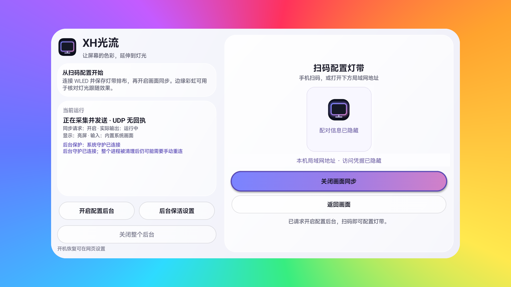

# XH光流 · XHFlow

让画面的色彩，延伸到屏幕之外。

[下载 0.4.3 测试版 APK](https://github.com/XHFO/XHFlow/releases/tag/v0.4.3) · [更新说明](https://github.com/XHFO/XHFlow/releases)



*电视真机截图，二维码和局域网地址已隐藏。*

XH光流是一款 Android 显示设备上的局域网氛围灯应用：由显示设备取色，通过 DDP 直接控制 WLED 灯带。运行链路为 **显示设备 → 局域网 → WLED**，无需电脑、采集卡或 Hyperion 中转。

当前适配目标为 **Redmi G Pro 32U 2026 / Android 14**。取色依赖该设备固件提供的原厂 TvService 接口，并非所有 Android 电视通用的屏幕录制能力。其他型号或固件需要独立验证。

## 功能

- 大圆角固定双栏电视界面；右侧扫码和同步按钮，保留屏幕边缘滚动彩虹用于测试灯光。遥控聚焦高亮与阴影不被内部容器裁切。

- 支持 C 字形和口字形灯带；可设置缺口、断开位置、各边灯珠数量与覆盖范围、首灯、方向及 WLED 起始灯号。
- 网页画布可分别移动和缩放屏幕与灯带方框，校准实际安装位置；背面观察只镜像预览，不改变保存的灯号。
- 两档边缘取色：标准共 20 点，每边 5 点；细腻共 40 点，每边 10 点。细腻会增加采样延迟。
- 支持取色缩进、保守黑边检测、灯光柔化、亮度与高级颜色校正。
- 可根据显示设备休眠和当前输入源暂停同步；可选在接口条件不满足时关闭灯带，并在条件恢复时恢复此前开启的同步。
- 电视本机提供网页控制台和配置二维码；配置保存在本机，可导入、导出 JSON。
- 已开启同步时使用“保存并应用”，回读配置及活动指纹后才确认生效；同步关闭时仅保存，不自动开启。

## 支持范围与限制

读取对象是面板边缘的原厂取色结果，设计上可跟随内置画面及 HDMI、DP、USB-C 输入。是否能读取某一来源、受保护内容或特定显示模式，由硬件与固件决定；不能据此承诺所有输入、DRM 内容或其他电视型号均可用。当前机型适配的来源列表包括 HDMI1、HDMI2、DP、USB-C 和内置系统画面；页面只展示设备实际确认的接口。

当前输出为 **1–480 颗 RGB 灯珠**，使用 UDP 4048 的 DDP RGB24。网页模型允许编辑和导出更大的布局，但超过输出上限时禁止保存到电视或开始同步。WLED 地址只接受私有局域网 IPv4，暂不支持主机名、自定义端口或 RGBW 输出。

取色点是沿边采样与插值，不能等同逐像素采集，也不能保证各点来自同一帧。细腻模式分两批串行读取，完整结果通过后才输出。黑边识别依赖稳定暗边证据，暗场不保证识别。网页屏幕内的渐变是边缘颜色生成的示意，**不是画面截图**；灯带草稿预览不模拟颜色校正、输出亮度与柔化。

局域网 HTTP 和 UDP 传输没有端到端加密。专属网页地址及二维码包含访问凭据，请只在可信局域网使用，并在反馈问题时隐去凭据。API 状态中的 `serverUrl` 也可能包含凭据。

后台运行受 Android 和厂商策略影响。可选辅助功能守护只用于维持服务宿主，不读取窗口、不监听按键、不执行手势。是否启用由用户在电视系统设置中手动决定；强行停止、厂商清理、撤销授权或断电后的自动恢复不作保证。

## 使用

1. 在支持的显示设备安装并打开应用，开启配置后台。
2. 用同一局域网中的浏览器扫描电视显示的二维码，或打开其完整专属配置地址。
3. 填写 WLED 地址并检测连接。示例中 WLED 为 `192.168.1.50`，电视为 `192.168.1.80`；请替换成自己的地址。
4. 按实际安装校准轮廓、灯珠数、起点和方向，保存配置。
5. 点击 **开启同步**。运行状态在旁边显示；总开关保持开启时，切回允许接口会自动恢复同步，若此前按接口条件关灯，也会恢复灯带电源。

“开启配置后台”和“开启画面同步”分别控制网页服务与灯光同步。“关闭同步”保留网页后台；“关闭后台”关闭 HTTP、取色和 UDP 输出。配置导入只修改草稿，保存并应用后才改变运行配置。

升级相同包名需要使用相同签名。导出 JSON 可备份布局和设置；卸载应用会清除其本地数据，导出文件也不包含应用安装身份和签名。

## 从源码构建

需要 Python 3.9+、JDK 17+，以及从 Android 官方工具安装的以下 SDK 包：

```sh
sdkmanager "platforms;android-34" "build-tools;35.0.0"
```

设置 `ANDROID_SDK_ROOT` 或 `ANDROID_HOME` 为 SDK 根目录。`JAVA_HOME` 可选；未设置时从 `PATH` 查找 JDK 工具。

```sh
export ANDROID_SDK_ROOT=/path/to/android-sdk
python3 scripts/build.py
```

输出为 `build/xh-flow.apk`。脚本使用官方 `platforms/android-34/android.jar` 和 `build-tools/35.0.0/`，编译资源和 Java、生成 DEX、对齐 APK、签名并验证签名；不连接或操作设备，也不发布文件。公开版本要求 Manifest 的 `android:debuggable=false`，脚本会检查源 Manifest 和最终 APK。

默认生成本地测试签名，保存在被忽略的 `build/signing/`，不会进入源码仓库。普通重复构建保留此签名；删除该目录会生成新的签名。需要持续升级时，应另行保管自己的私密签名文件，并通过环境变量提供：

| 环境变量 | 用途 |
| --- | --- |
| `XHFLOW_KEYSTORE` | 仓库之外的私密 keystore 文件路径 |
| `XHFLOW_KEY_ALIAS` | 签名 alias |
| `XHFLOW_STORE_PASSWORD` | keystore 密码 |
| `XHFLOW_KEY_PASSWORD` | 私钥密码，省略时沿用 keystore 密码 |

密码通过环境变量交给签名工具，不写入脚本或配置文件。仓库不附带任何设备使用过的签名。

## 测试

网页测试使用 Node.js 20+，无 npm 运行时依赖：

```sh
python3 scripts/test.py --web-only
```

完整测试还需要 JDK 17+ 和前述官方 `platforms;android-34`，并设置 `ANDROID_SDK_ROOT` 或 `ANDROID_HOME`：

```sh
python3 scripts/test.py
```

首次 Java 测试会从官方 Maven Central 下载固定的 `org.json:json:20240303`，在 `build/deps/` 缓存并验证 SHA256。离线环境可显式提供相同 JAR：

```sh
python3 scripts/test.py --java-only --json-jar /path/to/json-20240303.jar
```

Java 测试编译完整应用真实源码，以官方 Android 平台库提供类型依赖，主机运行时优先使用真实 JSON-java；不以替身覆盖应用测试目标，也不启动 Android 服务。测试覆盖 DDP 数据、HTTP 鉴权与解析、布局、采样、柔化、颜色校正、运行条件、配置指纹及带假传输的 WLED 电源回读。二维码测试只生成合成地址，输出在被忽略的 `build/test-output/`。测试不访问电视或真实 WLED，HTTP 超时测试仅使用本机回环连接。

仓库提供 [GitHub Actions 模板](docs/ci.example.yml)，需要时可复制到 `.github/workflows/ci.yml` 启用。模板在临时环境中运行测试，以临时测试签名构建并验证 APK；不上传 APK、不使用私密发布密钥，也不创建 Release。源码测试和 APK 构建不能替代真实设备的取色、后台、接口切换及灯光验收。

## 目录

```text
app/
  AndroidManifest.xml
  src/                 Android Java 源码和保留许可的二维码依赖
  res/                 原生图标与资源
  assets/              APK 第三方许可声明
  tests/               仅 Java 测试源码
  third-party/         上游来源、版本、校验与许可说明
web-console/           网页源码、原创图标及 Node 测试
scripts/               官方 SDK 构建和主机测试脚本
docs/ci.example.yml    可选的 CI 模板（尚未启用）
```

`web-console/` 是网页的唯一源码；构建脚本只将 `index.html`、`styles.css`、`model.js`、`app.js`、`console.js`、`mark.svg` 与第三方许可声明加入 APK，网页测试和开发说明不打包。

## 局域网 API

API 由电视本机 8768 端口提供，携带本机生成的 `X-TVWLED-Token` 请求头；写请求使用 JSON，并受私网来源、Host 与同源校验约束。无凭据的网页为本地演示，不会发设备请求。

| 路由 | 用途 |
| --- | --- |
| `GET /api/status` | 请求状态、实际输出、暂停原因、已确认输入源、电源回读、保存/活动配置指纹 |
| `GET /api/config` | 完整保存配置或 `null` |
| `POST /api/config` | 仅保存并返回本次保存指纹；不隐式开启同步 |
| `POST /api/start` | 显式开启或重载保存配置 |
| `POST /api/stop` | 停止同步，保留配置后台 |
| `POST /api/probe` | 读取指定私网 WLED 的信息 |
| `GET /api/preview` | 原始 20/40 点颜色及有效画面区域；暂停、失败、过期时不可用 |

`enabled` 表示用户开启意图，`running` 表示有新鲜取色和近期实际发包。指纹一致只证明活动配置已经加载，不证明当前接口允许、灯带已接收或视觉效果正确。DDP 是 UDP，无接收回执。

## 验证

0.4.3 的真机界面、五按钮焦点、字体缩放、实际取色与 WLED 输出结果见 [验证记录](docs/VALIDATION.md)。

## 许可

本项目采用 [MIT License](LICENSE)。二维码依赖及仅用于主机测试的 JSON 依赖说明见 [NOTICE.md](NOTICE.md)。
